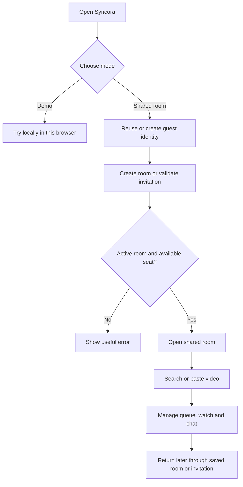
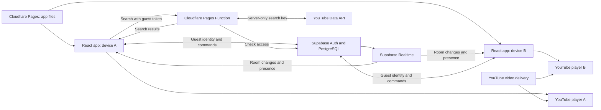
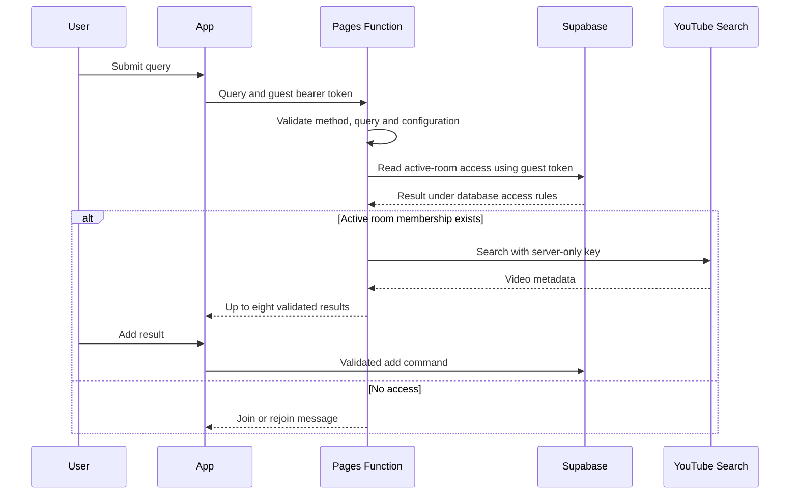
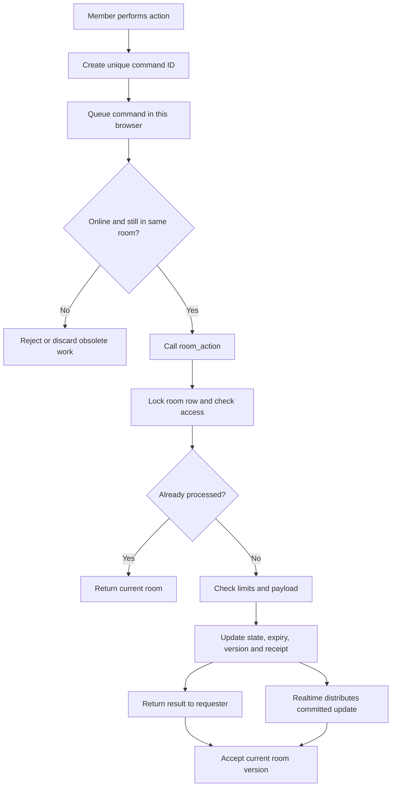
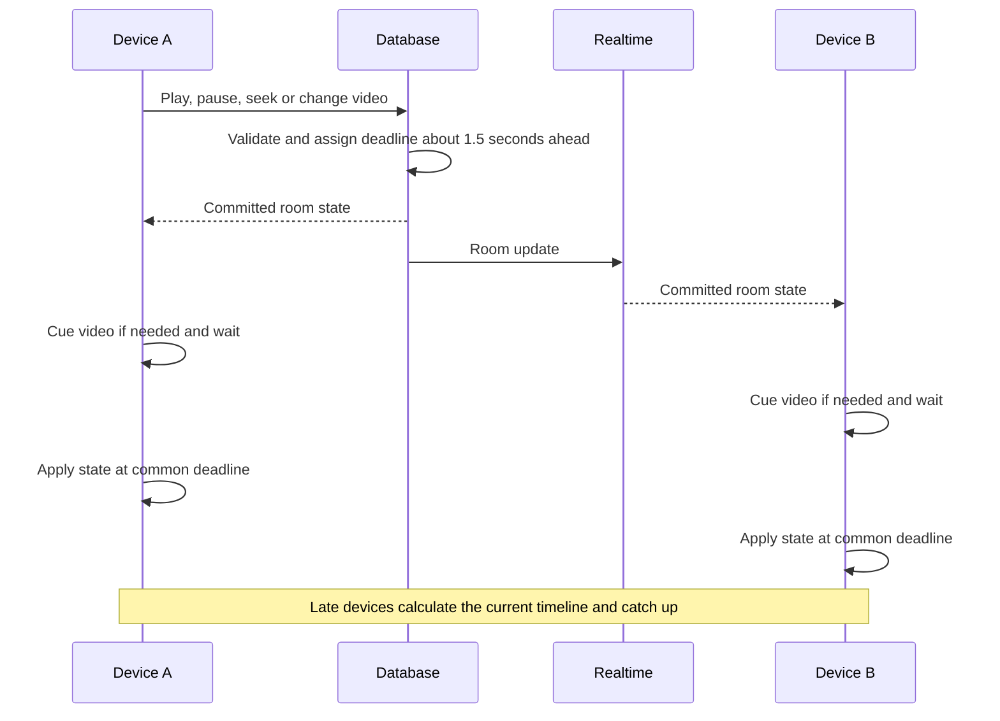
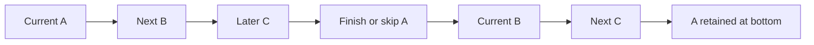
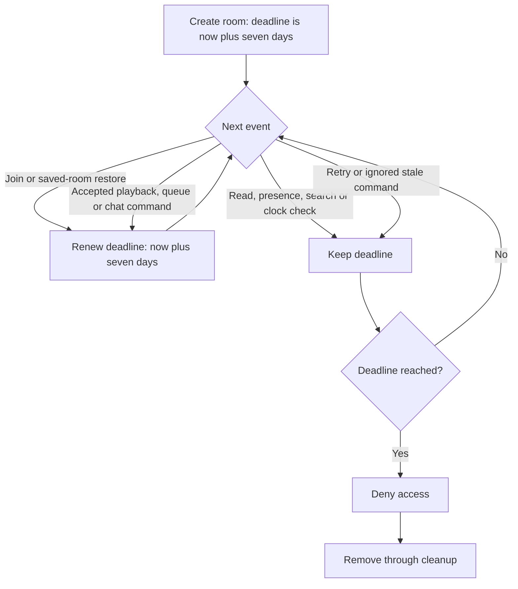
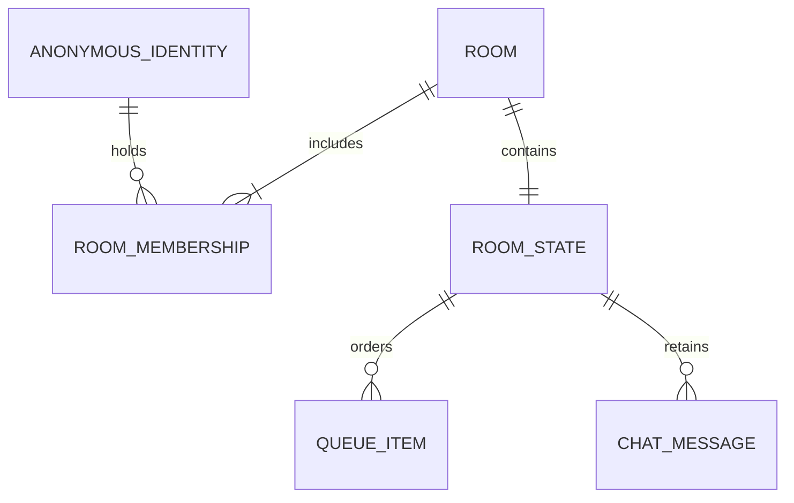
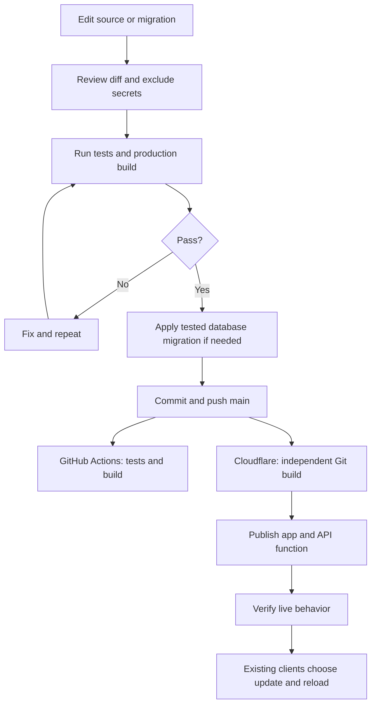

# Syncora — Complete Project Walkthrough

- **Audience:** managers, reviewers and developers
- **Prepared:** 22 October 2026
- **Live app:** [syncoramoments.pages.dev](https://syncoramoments.pages.dev/)
- **Repository:** [visheshgupta0404/Syncora](https://github.com/visheshgupta0404/Syncora)

> Syncora lets up to six people in different locations watch YouTube together, manage a reusable playlist and chat in a private room. It is a deployed web application with home-screen installation, not a native Android/iOS app.

**Jump to:** [Presentation steps](#1-how-to-explain-the-project-to-a-manager) · [Architecture](#3-architecture) · [Technology choices](#4-technology-choices-and-reasons) · [Feature implementation](#5-feature-implementation) · [Security](#7-security-and-privacy) · [Deployment](#10-development-and-deployment-workflow) · [Manager questions](#14-questions-to-expect-from-a-manager)

## 1. How to explain the project to a manager

Present the problem and demonstration before implementation details. Use the following order; the rest of this document supplies the explanation for each step.

| Step | Explain | Show |
| --- | --- | --- |
| 1 | The problem: coordinating videos, playback and messages across different locations | One-sentence introduction |
| 2 | The experience: create, invite, choose and watch | A two-device demonstration |
| 3 | What has been delivered | Feature walkthrough |
| 4 | How the parts fit together | Architecture diagram |
| 5 | Technology choices and their tradeoffs | Stack table |
| 6 | How features are implemented | Workflows below |
| 7 | Security, recovery and data retention | Access and lifecycle diagrams |
| 8 | Testing and release process | Deployment flowchart |
| 9 | Current limitations and next priorities | Delivery assessment |

Suggested opening: **“I built Syncora to make a shared YouTube session easy for a small group. The main engineering work was keeping everyone on the same room state while protecting private access and handling unreliable networks.”**

The reasons below explain why the implemented choices fit this scope. They do not imply that every alternative was benchmarked or prototyped.

## 2. User experience

Users enter a display name and create or join a room. No separate registration is required, but Supabase creates an anonymous identity behind the scenes. Display names are not verified identities. Every admitted member has equal playback control; there is no host-only moderation role.



Success means a second participant can join, see the same queue and messages, and follow the shared playback timeline on their own player.

## 3. Architecture



**The key distinction:** the backend shares instructions, queue and chat. It does not stream audio/video or share one person's screen. Each device receives media through YouTube's official player. This avoids building a media-hosting service, but YouTube buffering and device restrictions remain outside Syncora's control.

## 4. Technology choices and reasons

| Technology | What it does | Why it fits | Tradeoff |
| --- | --- | --- | --- |
| React 19 and React DOM | Components, state and rendering | Separates player, search, queue and chat responsibilities | Asynchronous state and effects require care |
| JavaScript modules | Frontend, endpoint and tests | One language keeps the project straightforward | No TypeScript compile-time checking |
| Plain CSS | Responsive styling | Direct control without a UI framework | Layout and accessibility consistency remain our responsibility |
| Vite and React plugin | Development server and production build | Fits a client-rendered app without a custom rendering server | Local Vite does not provide the hosted search endpoint |
| Supabase Auth | Anonymous guest identities | Low-friction joining with server-checked identities | Clearing browser data can lose the old identity |
| PostgreSQL on Supabase | Durable rooms, validation, permissions and transactions | Row locks make concurrent shared edits predictable | Requires maintained SQL functions and migrations |
| Supabase Realtime | Room updates and online presence | Avoids operating a separate WebSocket server | Recovery reads remain necessary after interruptions |
| Supabase JavaScript client | Auth, reads, RPC and subscriptions | One client integrates the chosen backend | Coupling to Supabase APIs |
| YouTube IFrame Player API | Official embedded video playback | Supported player rather than extracted media | Ads, embedding restrictions and autoplay behavior remain |
| YouTube Data API v3 | Search results | Official video discovery inside the app | Server key and quota management required |
| Cloudflare Pages | HTTPS hosting and Git deployment | No dedicated frontend server to operate | Provider settings and limits need monitoring |
| Pages Functions | Private-key search endpoint | Keeps the YouTube key out of public frontend code | Needs access checks, timeouts and safe errors |
| vite-plugin-pwa and Workbox | Manifest, service worker and update prompt | Installation and cached app shell using the same code | Does not provide offline video or unrestricted background execution |
| Node.js test runner and PGlite | Logic and embedded PostgreSQL tests | Exercises real SQL locally without a hosted test database | Does not prove phone behavior or external-service availability |
| GitHub Actions | Repeatable tests and builds | Verification runs on main pushes and pull requests | Current Pages deployment runs independently |
| Prettier | Formatting | Consistent code presentation | Not a correctness or security check |

### Why Supabase rather than a custom backend?

We need identity, persistent state, access rules and live updates. Supabase supplies these together. A custom server would also need authentication, database integration, WebSocket connection management and server operations.

PostgreSQL provides a useful guarantee: two participants cannot edit the same room row at the same time. A transaction locks the row, validates one command, commits it and then lets the next command proceed. The database is the authority for shared state.

This reduces custom infrastructure for the small-group scope. It does not remove backend engineering: validation, authorization, rate limits and upgrade migrations are still coded.

### Why a PWA rather than separate native apps?

One web application serves desktop, Android and iPhone. Home-screen installation makes repeat access easier without maintaining separate native applications. The tradeoff is less control over mobile background execution and operating-system integration.

### Why no separate Express server or global state library?

SQL functions handle shared mutations, a Pages Function handles private-key search, and React state/refs plus a room hook manage the client. Additional services and state libraries would add maintenance before a demonstrated need.

## 5. Feature implementation

### 5.1 Create, join and invite

**Code:** [useRoom.js](../src/hooks/useRoom.js), [backend.js](../src/lib/backend.js), [main.jsx](../src/main.jsx), [schema.sql](../supabase/schema.sql).

1. Reuse an existing guest session or sign in anonymously.
2. Call `open_room`, a database function through RPC: a named backend operation.
3. For creation, generate a ten-character hexadecimal invitation, shown in two groups of five.
4. For joining, normalize the code, check expiry, lock the room and check membership/capacity.
5. Return the room, update the frontend and save its reference for returning later.

The limit is six identities per room and five active room memberships per identity. Creation retries invitation collisions up to five times. Older 32-character invitations remain valid through a legacy-code alias.

Links use a URL fragment such as `#room=...`. Syncora removes it before mounting the YouTube player so the widget does not receive the invitation in its page URL. The WhatsApp button opens a prefilled message; the user chooses a recipient and sends it. A room code is an invitation, not a verified account password.

### 5.2 Search and add videos

**Code:** [AddVideos.jsx](../src/components/AddVideos.jsx), [YouTubeSearch.jsx](../src/components/YouTubeSearch.jsx), [youtube-search.js](../functions/api/youtube-search.js), [model.js](../src/lib/model.js).

Search, Queue and Conversation have separate tabs. Pasting accepts supported YouTube hosts and validated video IDs, rejecting lookalike URLs. Search runs on form submission, not each keystroke.



The access check confirms membership in an active room; the request does not supply a room ID for separate per-room search authorization. Search itself does not renew expiry.

The endpoint requests embeddable, syndicated videos and returns ID, title, channel and thumbnail. Playback restrictions can still apply. It uses request timeouts, no-store responses and safe errors for missing configuration, quota and connection failures. Pasting links remains available.

`YOUTUBE_API_KEY` stays in Cloudflare secrets. It has no `VITE_` prefix because Vite frontend settings become public JavaScript. Result titles are rendered as text.

### 5.3 The shared command path

**Code:** `dispatch` in [useRoom.js](../src/hooks/useRoom.js), `room_action` in [schema.sql](../supabase/schema.sql).



The client serializes its own commands; PostgreSQL serializes edits across participants. Each room retains 2,048 recent command receipts. An ambiguous network failure is retried once with the same ID, protecting against duplicate effects. This is bounded retry protection, not permanent deduplication history.

Offline edits are rejected instead of being replayed later. Increasing room versions and a client session-generation counter prevent old responses or previous-room requests from replacing current state.

### 5.4 Shared playback and timing

**Code:** [Player.jsx](../src/components/Player.jsx), [playerSync.js](../src/lib/playerSync.js), [backend.js](../src/lib/backend.js), `room_action`.

The room stores the current video, playing/paused state, saved position and server timestamp. Each device calculates its expected position. While playing, this is the saved position plus elapsed time since the shared timestamp; while paused, it remains the saved position. Elapsed time is zero before a future deadline.



Clock estimation makes three server requests and uses the fastest round trip to estimate the device offset. It refreshes approximately every two minutes and when the app becomes visible again.

The player samples roughly every 750 milliseconds. Normal correction handles drift above one second. Event suppression prevents Syncora's own player updates from feeding back as new user commands. Native YouTube controls remain visible; native seeks and play/pause events can publish shared commands.

Automatic end-of-video commands include the current track key and timestamp. If multiple devices finish together, stale commands cannot advance the queue repeatedly.

**Why not 0 ms?** A shared deadline coordinates instructions, not exact media-frame delivery. Network asymmetry, buffering, advertisements, autoplay and device scheduling remain outside our control.

### 5.5 Resync and restart

Resync immediately seeks the requesting player to the shared timeline and restores playing or paused state. For six seconds it checks local drift above 0.25 seconds when the player is not buffering. Recovery events are kept from publishing shared changes during this window. A new shared playback state supersedes recovery.

Restart video sends a shared seek to zero and preserves paused/playing state. The separate playlist restart command starts the top entry, or replays the current item when applicable. Resync does not ask everyone else to pause while one device catches up.

### 5.6 Reusable shared playlist

**Code:** [Queue.jsx](../src/components/Queue.jsx), [model.js](../src/lib/model.js), `room_action`.

The queue is an ordered list; `current.key` identifies the active entry. Every entry has a queue key, YouTube ID and title. Separate queue keys allow the same YouTube video to be added as distinct entries.

| Action | Behavior |
| --- | --- |
| Add | Append an entry, up to 100 videos |
| Move or Play next | Change order through validated commands |
| Play | Select an entry and rotate the previous current entry to the bottom |
| Finish or Next | Rotate current to bottom when multiple entries exist |
| Single video finishes | Stop instead of looping automatically |
| Pause | Keep order unchanged |
| Previous | Rotate in reverse |
| Remove current | Stop playback while retaining other entries |



The current entry is pinned at the top and highlighted; the next is labelled Up next. Thumbnails use YouTube image URLs with lazy loading. The local demo uses a JavaScript reducer; shared rooms use SQL validation, with both covered by tests.

### 5.7 Conversation

**Code:** [Chat.jsx](../src/components/Chat.jsx), `room_action`.

Messages use the same command path as the queue. The server supplies sender identity, command-based message ID and timestamp; names remain user-entered labels. Limits are 500 characters per message, 30 per name and 100 retained messages.

The UI shows dates, initials, names and times. Enter sends, Shift+Enter adds a line, and composition-aware input avoids prematurely sending composed text. Successful sends clear the field. New messages auto-scroll only when the user is near the bottom.

Chat is durable room state, not a separate chat server. This is simple for small groups, but changes transmit a room snapshot containing retained messages rather than independently paginated chat records.

### 5.8 Presence, reconnection and leaving

**Code:** [useRoom.js](../src/hooks/useRoom.js).

Private presence counts online identities. Membership is different: a closed browser can still hold a seat. Tabs sharing an identity count once in presence.

Realtime is the primary update path. A visible app also reads the room every 15 seconds as recovery and refreshes after subscription, visibility changes and network return. These passive reads do not renew expiry.

Back to lobby preserves the saved room reference and membership. Release my seat first opens a confirmation, warning explicitly when the last seat release will delete the room. Keep my seat is focused by default; confirmed release calls `leave_room` and removes membership. The last release deletes the room and its queue/chat. Closing the tab alone does not release a seat.

### 5.9 Seven-day inactivity expiry

**Code:** [inactivity migration](../supabase/migrations/20261021_inactivity_expiry.sql), `open_room` and `room_action`.



Using a room on day 4 moves its deadline to day 11. Existing rooms keep their deadline until qualifying use; expired rooms cannot be revived by joining.

Accepted automatic playback transitions also renew expiry because they use `room_action`. There is no separate human-interaction timestamp. An idle tab receiving refreshes alone does not renew the deadline.

Access ends at expiry, but physical deletion happens during successful room-open cleanup or administrator cleanup, not necessarily at the exact expiry second. Supabase anonymous accounts have a separate maintenance lifecycle.

### 5.10 Interface, notifications and full screen

**Code:** [main.jsx](../src/main.jsx), [style.css](../src/style.css), [Player.jsx](../src/components/Player.jsx).

CSS adapts the layout to screen width. Search, Queue and Conversation tabs reduce clutter. Notifications clear after three seconds; a new notice restarts the timer, and manual dismissal remains available.

The lobby uses an original generated listening-lounge illustration, served as optimized local WebP assets in desktop and phone sizes. CSS supplies camera-like movement, independently floating large headphones, wired earphones and a distinct movie-night illustration, a rotating record, light ripples, particles and decorative audio bars. These bars are visual decoration, not analysis of YouTube audio. Desktop pointer movement and mobile scrolling adjust depth through requestAnimationFrame updates; listeners and pending frames are cleaned up. Pause, hidden-page and reduced-motion states stop motion. The scene unmounts inside rooms. No animation library or remote artwork requests are required.

Lobby music uses the supplied Coffee Shop Warmth MP3 from local hosting and attempts to start at 100% volume on arrival. Browser autoplay policy may block audible playback; in that case the image's music-note button displays a slash and Tap for sound. The same button enables, mutes or unmutes the looping native audio; muted playback continues silently. Audio controls remain independent of decorative motion. Entering a room pauses and clears the media source and invalidates pending playback attempts. The MP3 is not included in the app-shell precache.

Full screen uses the browser API where possible, otherwise it directs the user to YouTube's native control. PiP and separate plus/minus-ten-second buttons were removed. Native YouTube controls remain available.

### 5.11 Installation, updates and demo storage

**Code:** [Install.jsx](../src/components/Install.jsx), [vite.config.js](../vite.config.js), [storage.js](../src/lib/storage.js).

The manifest provides icons, theme and standalone display. Workbox caches the app shell; API navigation is excluded from the fallback. Shared rooms, search and videos still require internet.

Browsers that offer an install prompt can use it; others receive instructions. iPhone installation uses Safari's Share menu. An available service-worker update is applied when the user chooses the reload button.

Demo state is stored only in that browser and restored paused. Shared-room chat is not copied into demo storage. Syncora saves the display name and room reference, while Supabase manages its own session persistence. Storage and installations belong to each origin, so switching hostnames does not transfer a browser session.

## 6. Data model



This is a conceptual diagram. Physically, membership is an array and queue/chat are JSON inside `rooms`; they are not separate membership/message tables.

| Field | Purpose |
| --- | --- |
| `rooms.id` | Internal UUID |
| `code`, `legacy_code` | Current invitation and optional old alias |
| `members` | Guest UUIDs holding seats |
| `state.queue`, `state.current` | Ordered entries and selected entry |
| `state.playing`, `position`, `at` | Shared playback timeline |
| `state.messages` | Latest 100 messages |
| `version` | Increasing revision |
| `recent_commands` | Bounded retry receipts |
| `expires_at` | Inactivity deadline |
| `room_limits` table | Per-identity request buckets |

## 7. Security and privacy

Row-level security, or RLS, checks access inside the database. Reads require membership and an unexpired room. Clients cannot directly insert/update/delete rooms; mutations use validated security-definer functions with a fixed search path and explicit checks. Private presence has a separate membership policy.

| Protection | Implementation and boundary |
| --- | --- |
| Access | Guest session, membership and expiry checks; invite holders can join available seats |
| Writes | Payload validation and row locks; members still have equal control |
| Search key | Server-only secret, never bundled into frontend |
| Public configuration | Build validation rejects common secret/service-role key mistakes; public keys still rely on RLS |
| Browser protections | CSP, frame restrictions and disabled camera/mic/location permissions |
| Content | Typed/size/length checks and React text rendering |
| Signup | Cloudflare Turnstile is enabled for new guest sessions; Supabase validates tokens server-side |
| Privacy | Members and database administrator can read chat; no end-to-end encryption |

The secured RPC commits outer per-identity budgets even when room guesses or commands fail: ten opens and 120 action attempts per minute, with a separate 30 successful chat messages per minute limit. Search requires membership and an atomic reservation: six requests per minute and 30 per rolling day per guest, with 80 reservations per rolling day across the deployment. Room creation has a shared 200-attempt daily ceiling. These budgets do not replace provider-level IP limits or protect against all distributed traffic.

YouTube receives playback requests and Google receives search terms. Syncora does not extract media, hide ads/branding or bypass embedding restrictions. There is no claim of an independent security audit or hardened large-scale public service.

## 8. Failure handling

| Situation | Response |
| --- | --- |
| Invalid, expired or full room | Reject join with an explanation |
| Connection drops | Show offline/reconnecting state and refresh on return |
| Ambiguous command response | Retry once with same ID; deduplicate recent receipts |
| Obsolete player event | Ignore stale key/timestamp commands |
| Search quota or connection problem | Explain error; retain paste-link option |
| YouTube rejects video | Show error with retry or choose another video |
| Autoplay blocked | Request a local tap to enable playback |
| Demo storage unavailable | Warn that reload persistence is unavailable |
| Concurrent edits | Serialize under the room lock and distribute committed state |

## 9. Repository layout

```text
src/components/   Player, queue, search, chat, CAPTCHA and installation
src/hooks/        Room lifecycle, subscriptions and commands
src/lib/          Backend client, model, playback decisions and storage
src/main.jsx      Lobby, app layout, invitations and help
src/style.css     Responsive styling
functions/api/    Private-key search endpoint
supabase/         Schema and ordered upgrade migrations
public/           Icons, routing and security headers
scripts/          Configuration and hosted integration checks
tests/            Model, SQL, search and configuration tests
.github/          Verification and optional deployment workflows
docs/             Management, implementation, setup and acceptance guides
```

The ignore file excludes environment secrets, dependencies, builds, caches, logs, editor settings, local Cloudflare state and temporary outputs. Source, lockfile, tests and migrations stay tracked so another developer can reproduce and maintain the service.

## 10. Development and deployment workflow



The owner requested direct work on `main`. Pages builds it with Node 24, `npm run build` and output directory `dist`. GitHub verification and Pages publishing are separate; a passing GitHub check is not currently an enforced deployment gate.

SQL migrations are applied separately in Supabase. A push does not execute them. Future incompatible changes require a planned migration/client rollout. The current schema supports fresh installations; dated files support existing databases.

An optional manual GitHub deployment workflow is retained as an alternative. It requires configured public variables and scoped Cloudflare credentials.

## 11. Testing and evidence

The latest completed implementation check passed **32 tests and a production build**. This is the last feature validation result, not evidence that every phone or external failure scenario has been tested.

| Area | What is checked |
| --- | --- |
| Model | URLs, invitations, queue behavior and invalid commands |
| Playback decisions | Drift, buffering, timestamps and local resync |
| Embedded PostgreSQL | Functions, RLS, capacity, retries, migrations and inactivity expiry |
| Search endpoint | Authentication, result filtering and safe errors using mocked external requests |
| Configuration | Common privileged-key mistakes |
| Optional hosted checks | Supabase access, realtime and command behavior with temporary rooms |

`npm run test:live` removes its test room data, but leaves anonymous Auth identities for administrator review. Run it only against an authorized project.

Hosted room access, search, realtime and deployment have been checked during development. Physical Android/iPhone playback, installation and measured drift remain separate acceptance tasks. Exact zero-millisecond timing has not been established.

## 12. Costs, scaling and maintenance

The app uses free Supabase/Cloudflare tiers and quota-limited YouTube search. This fits the initial small-group goal within provider allowances; it is not unlimited free capacity. Services may pause when inactive and quotas can be exhausted.

**Six people per room is not the service's total user capacity.** Concurrent-room capacity depends on database work, connection counts, payloads and provider limits and has not been established through load testing.

As adoption grows, review whole-room snapshot size, search abuse protection, anonymous-account cleanup, dependency updates, production monitoring and backup/recovery procedures. Smaller events or separate message/queue tables should follow measured traffic, rather than be introduced without evidence. Staging or deployment gates would help if more developers contribute.

## 13. Delivery status and priorities

**Delivered:** private rooms, invitations, search, reusable queue, shared controls, chat, local resync, responsive UI, PWA installation support, timed notifications and inactivity expiry.

**Not delivered or promised:** browser extension, native apps, guaranteed background audio, exact 0 ms sync, host moderation, verified user accounts, end-to-end encryption, unlimited free capacity or measured large-scale readiness. PiP is not a Syncora feature.

Recommended next steps:

1. Complete real Android/iPhone two-device and six-participant acceptance sessions.
2. Enable and verify signup CAPTCHA before broader public promotion.
3. Measure join success, return usage, search demand and playback drift without unnecessary personal data.
4. Assign ownership for monitoring, quotas, account cleanup and recovery procedures.
5. Choose future features from observed needs; an extension adds an access route, not a synchronization fix.

## 14. Questions to expect from a manager

**Is the project complete?** The core service is deployed. Device acceptance and operational readiness are separate from feature completion.

**Why the 1.5-second delay?** Devices receive a common future execution point instead of acting at different message-arrival times.

**Can users open Clock to set an alarm?** Yes, but audio and sync may stop while backgrounded. Returning triggers recovery; Resync helps catch up.

**Does everybody need an account?** No registration; an anonymous backend identity still enforces access.

**Can capacity increase?** The six-seat policy can change, but UI, live-update traffic and backend capacity need testing too.

**Who delivers video?** YouTube delivers media to each player. Syncora still uses hosting, database, realtime and search resources.

**What happens if an invitation leaks?** Someone holding it can request an available seat. Keep invitations private; they are access tokens in practice.

**What makes maintenance manageable?** Separated components, one shared command path, migrations, reproducible builds, automated tests and focused documentation. A person must still own operations and changes.

## 15. Closing explanation

“Syncora is a working small-group viewing service. One React app provides the experience, Supabase manages trusted room state and updates, Cloudflare hosts the app and private-key search, and YouTube handles media. The main safeguards are validated atomic commands, retry protection, shared timing and recovery. The next milestone is measured device acceptance and operational readiness, rather than promising behavior the browser or YouTube cannot guarantee.”

---

[Short management overview](PROJECT-OVERVIEW.md) · [Deployment](DEPLOYMENT.md) · [Search setup](YOUTUBE-SEARCH.md) · [Acceptance checklist](VERIFICATION.md)


### Security hardening (23 October 2026)

Room opens/actions now go through `secure_room_request`: an outer transaction budget survives rejected guesses and malformed commands; only the mutation block rolls back. Direct legacy mutation RPCs are no longer callable by guests. Search first reserves an atomic database budget through `reserve_youtube_search`, checking active membership before contacting Google. See [the security review](SECURITY-REVIEW.md) for limits, abuse cases, verification and remaining provider-level risks.
